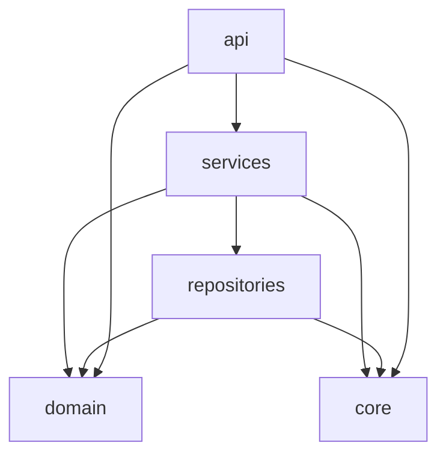
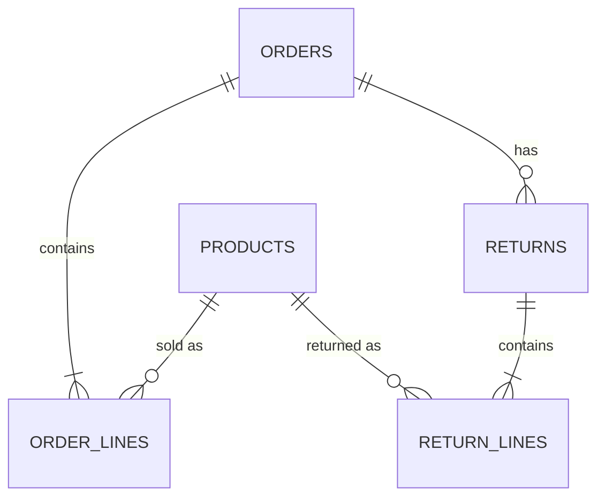
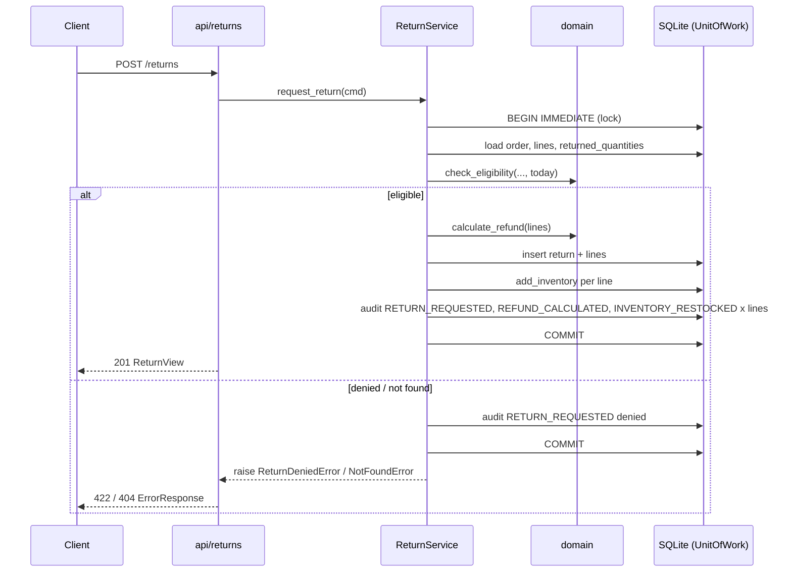

# Architecture Spine — Retail Returns Assistant

## Design Paradigm

The design is **layered**, with a pure domain core. Each layer maps to one package under `src/retail_agent/`:

| Layer | Package | Owns |
| --- | --- | --- |
| API | `api/` | FastAPI routers, request/response schemas, exception handlers, dependencies |
| Services | `services/` | Use cases, transaction boundaries, audit calls |
| Domain | `domain/` | Entities, enums, rules, refund, money helpers, audit details, errors. No I/O. |
| Repositories | `repositories/` | SQL against SQLite, `schema.sql`, seed data |
| Core | `core/` | Clock, DB connection + UnitOfWork, settings constants |

## Invariants & Rules



### AD-1 — Layer dependency direction

- **Binds:** all
- **Prevents:** routers running SQL, and business rules ending up in routers or repositories.
- **Rule:** Imports follow the graph above and nothing else:
  - `api` never imports `repositories`.
  - `services` and `domain` never import `fastapi` or `starlette`.
  - `domain` imports only the standard library and Pydantic.

  Eligibility (FR-4), refund (FR-8) and money conversion live in `domain` as pure functions. Enforced by `tests/test_architecture.py` (an AST scan, run in CI).

### AD-2 — One shared in-memory database per app instance [ADOPTED]

- **Binds:** FR-15, NFR-4, NFR-6, all repositories
- **Prevents:** each connection getting its own empty `:memory:` database, and tests leaking state into each other.
- **Rule:**
  - `create_app(clock=None, seed=True)` in `main.py` opens **one** connection with `sqlite3.connect(":memory:", check_same_thread=False, isolation_level=None)` and runs `PRAGMA foreign_keys = ON`.
  - It then applies `repositories/schema.sql`, seeds through `repositories/seed.py` with the app's clock, and stores the connection on `app.state`.
  - The module-level `app = create_app()` exists for uvicorn.
  - Uvicorn runs with **one worker**.
  - Each test builds its own app via `create_app`.

### AD-3 — Transactions: one per request, owned by the entry-point service method

- **Binds:** FR-1, FR-3, FR-6, FR-7, FR-9, FR-10, FR-11, FR-12, FR-14
- **Prevents:**
  - two return requests both claiming the last unit
  - a partial write
  - reads of uncommitted data
  - a deadlock from nested transactions on the non-re-entrant lock
- **Rule:**
  - `UnitOfWork.transaction()` (in `core/db.py`) takes a process-wide `threading.Lock`, issues `BEGIN IMMEDIATE`, and commits or rolls back.
  - Opening a transaction while one is already active raises `RuntimeError`.
  - **Every** database access, reads included, runs inside a transaction.
  - Only *entry-point* service methods, the ones routers call, open a transaction. Everything they call (other services, `AuditService.record`, repositories) asserts `uow.in_transaction` and never opens or commits one.
  - Repositories never call `commit`.
  - Accepting a Return is **one** transaction that re-reads the returnable quantities, inserts the Return and its Return Lines, Restocks, and writes all its Audit Events.
  - Inventory has one write path, `ProductRepository.add_inventory`, which is called only from inside that transaction.

### AD-4 — Audit Events are written only by services, through `AuditService.record`

- **Binds:** FR-2, FR-11, FR-12, FR-13
- **Prevents:** duplicate or missing events, mismatched action and outcome names, and personal data in the audit log.
- **Rule:**
  - `AuditService.record(action: ActionType, outcome: Outcome, details: <typed model>, order_id=None, return_id=None)` is the only writer.
  - The `ActionType` and `Outcome` enums are in `domain/enums.py`. The details models are in `domain/audit_details.py`.
  - None of the details models has an email field.
  - Services run **every check before any write**. On a denial or not-found, the service records the event, the transaction commits, and only then does the service raise its error, so the denial is persisted and nothing else is.
  - Any unexpected exception rolls back everything.
  - `AuditRepository` has no update or delete.

| ActionType | Outcomes | Details model (fields) | Count |
| --- | --- | --- | --- |
| `ORDER_LOOKUP` | `found`, `not_found` | `OrderLookupDetails` (none) | 1 per lookup |
| `RETURN_REQUESTED` | `accepted`, `denied` | `ReturnRequestedDetails` (`line_count: int`, `denial_reason: DenialReason \| None`) | 1 per request |
| `REFUND_CALCULATED` | `recorded` | `RefundCalculatedDetails` (`refund_amount: Decimal`) | 1 per accepted Return |
| `INVENTORY_RESTOCKED` | `recorded` | `InventoryRestockedDetails` (`sku: str`, `quantity: int`) | 1 **per Return Line** |
| `RETURN_VIEWED` | `found`, `not_found` | `ReturnViewedDetails` (none) | 1 per view |

### AD-5 — Money representation

- **Binds:** FR-8, all schemas carrying amounts
- **Prevents:** float rounding errors, different units across layers, and `"40"` appearing where `"40.00"` is meant.
- **Rule:**
  - The domain uses `decimal.Decimal`, quantized to `0.01` with `ROUND_HALF_UP`.
  - SQLite stores **INTEGER cents** (`*_cents` columns).
  - JSON carries a 2-decimal-place **string** (`"39.98"`).
  - The only conversions are `cents_to_decimal` and `decimal_to_cents` in `domain/money.py`, and repositories call them.

### AD-6 — Injected clock and timestamp format

- **Binds:** FR-4, FR-11, FR-15, NFR-6
- **Prevents:**
  - boundary tests that depend on the real date
  - seed data that slowly falls outside the window
  - audit timestamps that sort wrongly as text
- **Rule:**
  - `core/clock.py` defines the `Clock` protocol (`now() -> datetime` in UTC, `today() -> date`), `SystemClock`, `FixedClock`, and `format_ts(dt)`. `format_ts` produces exactly `YYYY-MM-DDTHH:MM:SS.ffffffZ`.
  - The clock is provided through a FastAPI dependency from `app.state.clock`.
  - No code outside `core/clock.py` calls `datetime.now`, `datetime.utcnow` or `date.today`.
  - Seed dates are documented **offsets from `clock.today()`** at `create_app` time (e.g. "delivered today − 12").

### AD-7 — Customer identity and email handling

- **Binds:** FR-1, FR-4, FR-7, FR-11
- **Prevents:** emails in access logs, query strings, errors or audit rows, and Order ID enumeration.
- **Rule:**
  - `GET` endpoints take the email in the `X-Customer-Email` header. `POST /returns` takes it as a body field.
  - The email is a plain non-empty `str` (no `EmailStr`), compared after `strip().lower()`.
  - An unknown ID and a wrong email raise the same `NotFoundError`, with the same message.
  - The email is never logged, audited, echoed in an error message, or returned.

### AD-8 — One error model

- **Binds:** FR-5, FR-14, FR-15, NFR-1
- **Prevents:** different routers using different error shapes, framework default bodies leaking out, and a 422 for a bad request firing ahead of the 404.
- **Rule:**
  - Services raise the errors in `domain/errors.py`: `NotFoundError`, `ReturnDeniedError(reason)`, `ServiceUnavailableError`.
  - `api/errors.py` registers handlers that all return `ErrorResponse` = `{"error": {"code", "message"}}`:

    | Error | Status | `code` |
    | --- | --- | --- |
    | `NotFoundError` | 404 | `NOT_FOUND` |
    | `ReturnDeniedError` | 422 | the `DenialReason` |
    | `RequestValidationError` | 422 | `INVALID_REQUEST`; `message` is built from `loc` and `type` only, never from `input` |
    | `ServiceUnavailableError` | 503 | `UNHEALTHY` |
    | Starlette `HTTPException` | its own status | `NOT_FOUND` / `METHOD_NOT_ALLOWED` |
    | any other `Exception` | 500 | `INTERNAL_ERROR` (no request data) |

  - Every route declares the shared `ERROR_RESPONSES` dict so that `/docs` shows the real error shapes.
  - `/healthz` goes through `HealthService.check()`.

### AD-9 — Returned quantity is derived, with one owner

- **Binds:** FR-1, FR-4, FR-6
- **Prevents:** a stored counter drifting away from the Return Lines, and the lookup and the eligibility check computing it differently.
- **Rule:** The quantity already returned per SKU comes from `ReturnRepository.returned_quantities(order_id) -> dict[sku, int]`, which runs `SUM(return_lines.quantity)` joined through `returns`. That is the only implementation. No `qty_returned` column exists. Until US-102 creates `return_lines`, the method returns `{}`.

### AD-10 — Single owners of shared definitions

- **Binds:** all stories
- **Prevents:** two stories each defining their own `Order` model, enum, schema or seed rows.
- **Rule:**
  - Domain entities live only in `domain/models.py` and enums only in `domain/enums.py`.
  - API schemas live only in `api/schemas.py`, with the fields in the API table below.
  - DDL lives only in `repositories/schema.sql`. Each story adds the tables it needs.
  - Seed rows live only in `repositories/seed.py`. A story adds rows but never changes existing ones.

### AD-11 — Single import root [ADOPTED]

- **Binds:** all code and tests
- **Prevents:** the same module loading twice as both `retail_agent.*` and `src.retail_agent.*`, which gives duplicate exception classes and enums, unmatched handlers and 500s.
- **Rule:**
  - The import root is `src.retail_agent`, as in the mandated run command.
  - `pyproject.toml` sets `[tool.uv] package = false` and pytest `pythonpath = ["."]`.
  - Imports inside the package are **relative**. Tests import `src.retail_agent...`.
  - `tests/test_architecture.py` fails if any file contains `import retail_agent` or `from retail_agent`.

### AD-12 — Ordered return rules

- **Binds:** FR-3, FR-4, FR-5, FR-6
- **Prevents:** schema-level and domain-level checks disagreeing about precedence, and denials that never get audited.
- **Rule:**
  - The request schema checks **types only**: `order_id: str`, `email: str`, `lines: list[{sku: str, quantity: int}]`. A missing field or wrong type gives 422 `INVALID_REQUEST` and is not audited.
  - `domain/eligibility.check_eligibility` evaluates these rules in order. Each rule is checked across all lines before the next rule runs, and the first rule that fails wins:
    1. Order found and email matches → otherwise `NotFoundError` (audited `denied`, `denial_reason: null`)
    2. `INVALID_REQUEST`: lines are empty, a SKU is duplicated, or a quantity is below 1
    3. `ORDER_NOT_DELIVERED`
    4. `RETURN_WINDOW_EXPIRED`: today > `delivery_date` + 30
    5. `ITEM_NOT_ON_ORDER`
    6. `ITEM_NOT_RETURNABLE`
    7. `QUANTITY_EXCEEDS_RETURNABLE`

## Consistency Conventions

| Concern | Convention |
| --- | --- |
| Naming | `snake_case` in Python and JSON. Tables are plural. Classes are named `<Noun>Service` / `<Noun>Repository`. |
| IDs | Seeded IDs look like `ORD-1001` and `SKU-JACKET`. A Return ID is `RET-` + 12 hex characters from uuid4. `event_id` is a uuid4 string. |
| Dates/times | Dates are ISO `YYYY-MM-DD`. Timestamps always go through `format_ts` (UTC, microseconds, `Z`). |
| Endpoints | All handlers are sync `def`. No URL version prefix. |
| Pagination | `limit` (1–200, default 50) and `offset` ≥ 0. Responses use `{items, total, limit, offset}`. |
| Audit filters | `order_id`, `action`, `from` (inclusive; `Query(alias="from")`) and `to` (exclusive). Order is `seq DESC`. |
| Logging | Standard `logging` to stdout. No bodies or headers are logged. |
| Config | Constants in `core/settings.py`. No `pydantic-settings`, no `.env`. |
| Tests | `tests/unit/` and `tests/api/` (TestClient, with `FixedClock` passed via `create_app`), plus `tests/test_architecture.py`. |

## API Endpoints

| Method + path | Input | Success body | Errors | FR |
| --- | --- | --- | --- | --- |
| `GET /healthz` | — | 200 `{status: "ok"}` | 503 | FR-14 |
| `GET /orders/{order_id}` | header `X-Customer-Email` | 200 **OrderView** | 404, 422 | FR-1, FR-2 |
| `POST /returns` | **ReturnRequest** | 201 **ReturnView** | 404, 422 | FR-3–FR-9 |
| `GET /returns/{return_id}` | header `X-Customer-Email` | 200 **ReturnView** | 404, 422 | FR-7 |
| `GET /inventory/{sku}` | — | 200 **InventoryView** | 404 | FR-10 |
| `GET /audit-events` | query per Conventions | 200 **AuditPage** | 422 | FR-12, FR-13 |
| `GET /docs`, `/openapi.json` | — | Generated | — | FR-15 |

| Schema | Fields |
| --- | --- |
| OrderView | `order_id`, `status`, `order_date`, `delivery_date \| null`, `return_eligible_until \| null`, `lines: [LineView]`, `returns: [ReturnSummary]` |
| LineView | `sku`, `name`, `quantity`, `unit_price` (money string), `quantity_returned` |
| ReturnSummary | `return_id`, `refund_amount`, `created_at` |
| ReturnRequest | `order_id`, `email`, `lines: [{sku, quantity}]` |
| ReturnView | `return_id`, `order_id`, `lines: [{sku, quantity}]`, `refund_amount`, `created_at` |
| InventoryView | `sku`, `name`, `quantity_on_hand` |
| AuditEventView | `event_id`, `occurred_at`, `action`, `outcome`, `order_id \| null`, `return_id \| null`, `details` |
| AuditPage | `items: [AuditEventView]`, `total`, `limit`, `offset` |
| ErrorResponse | `error: {code, message}` |

## Stack

| Name | Version |
| --- | --- |
| Python | 3.12 |
| FastAPI | 0.162.2 |
| Pydantic | 2.14.3 |
| uvicorn | 0.54.0 |
| SQLite | stdlib `sqlite3` |
| pytest | 9.2.0 |
| pytest-cov | 7.1.0 |
| httpx (TestClient) | 0.28.1 |
| pip-audit | 2.10.1 |
| bandit | 1.9.4 |
| uv | 0.13.7 |

## Structural Seed



| Table | Columns | Created by |
| --- | --- | --- |
| `products` | `sku` PK, `name`, `returnable` INT 0/1, `quantity_on_hand` INT | US-101 |
| `orders` | `order_id` PK, `customer_email` (lower-cased), `status`, `order_date`, `delivery_date` NULL | US-101 |
| `order_lines` | `order_id` FK, `sku` FK, `quantity` INT, `unit_price_cents` INT; PK(`order_id`, `sku`) | US-101 |
| `audit_events` | `seq` INTEGER PK AUTOINCREMENT, `event_id` UNIQUE, `occurred_at`, `action`, `outcome`, `order_id` NULL, `return_id` NULL, `details_json`. **No FKs**, because `not_found` events reference IDs that don't exist. | US-101 |
| `returns` | `return_id` PK, `order_id` FK, `refund_cents` INT, `created_at` | US-102 |
| `return_lines` | `return_id` FK, `sku` FK, `quantity` INT; PK(`return_id`, `sku`) | US-102 |



```text
src/retail_agent/
  main.py              # create_app(), module-level app
  api/                 # health, orders, returns, inventory, audit routers; schemas.py; errors.py; deps.py
  services/            # health, order, return, inventory, audit services
  domain/              # models, enums, errors, eligibility, refund, money, audit_details
  repositories/        # schema.sql, seed.py, *_repository.py
  core/                # clock.py, db.py, settings.py
tests/
  unit/  api/  test_architecture.py
Dockerfile  .dockerignore  .github/workflows/ci.yml  pyproject.toml  uv.lock
```

**Deployment & environments:**

- **Local:** `uvicorn src.retail_agent.main:app --port 8000`.
- **Docker:** `python:3.12-slim` with `COPY --from=ghcr.io/astral-sh/uv:0.13.7`. Runs `uv sync --frozen --no-dev` as a non-root user, then the same uvicorn command with `--host 0.0.0.0 --workers 1`. `.dockerignore` excludes `.env*`, `.git`, `.venv` and `tests`.
- **CI** (GitHub Actions, on every PR to `main`; required status checks under branch protection on `main`):
  1. `astral-sh/setup-uv` pinned to 0.13.7, then `uv sync --frozen`
  2. `uv run pytest --cov=src/retail_agent/domain --cov=src/retail_agent/services --cov-fail-under=90`
  3. `uv run pip-audit`
  4. `uv run bandit -r src --severity-level medium`
  5. gitleaks secret scan
  6. Docker build, then a `/healthz` smoke test

  There are no external services or secrets.

## Capability → Architecture Map

| Capability | Lives in | Governed by |
| --- | --- | --- |
| FR-1, FR-2 order lookup + audit | `api/orders`, `services/order_service` | AD-1, AD-3, AD-4, AD-7, AD-9 |
| FR-3–FR-6 return request, rules, denials | `api/returns`, `services/return_service`, `domain/eligibility` | AD-3, AD-4, AD-6, AD-8, AD-12 |
| FR-7 view Return | `api/returns`, `services/return_service` | AD-3, AD-7 |
| FR-8 refund | `domain/refund`, `domain/money` | AD-5 |
| FR-9, FR-10 restock + inventory | `services/return_service`, `services/inventory_service` | AD-3 |
| FR-11–FR-13 audit | `services/audit_service`, `api/audit` | AD-4, Conventions |
| FR-14 health | `api/health`, `services/health_service` | AD-8 |
| FR-15 docs + seed | `main.py`, `api/errors.py`, `repositories/seed.py` | AD-2, AD-6, AD-8, AD-10 |
| NFR-1 errors | `api/errors.py` | AD-8 |
| NFR-2–NFR-5 tests, scans, Docker, CI | `tests/`, `Dockerfile`, `.github/workflows/ci.yml` | AD-1, AD-11, Deployment |

## Deferred

- **Authentication / authorization.** Out of scope per the PRD. This includes an accepted risk: unfiltered `GET /audit-events` reveals real Order IDs, which undoes FR-1's anti-enumeration for anyone who can reach the API. Revisit before any shared deployment (PRD Q1).
- **Persistence across restarts.** In-memory by design (FR-15).
- **Multiple workers / scaling.** Blocked by AD-2, and not needed (NFR-7).
- **API versioning.** Revisit if the API gets external consumers.
- **Metrics and tracing.** Training scope.
- **Return cancellation** (PRD Q2). Would be a compensating transaction under AD-3.
- **Lint tooling** (`import-linter`, ruff banned-API rules). The AST test in AD-1/AD-11 covers enforcement for now.
